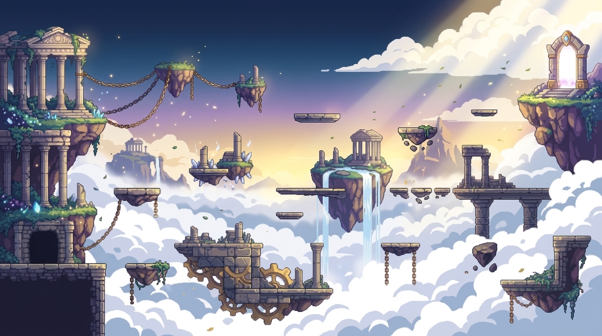
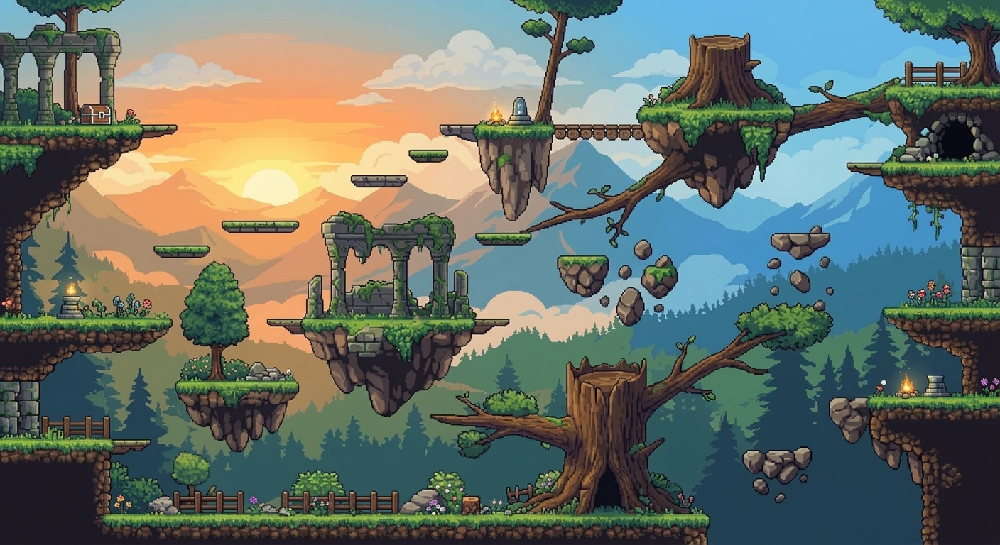
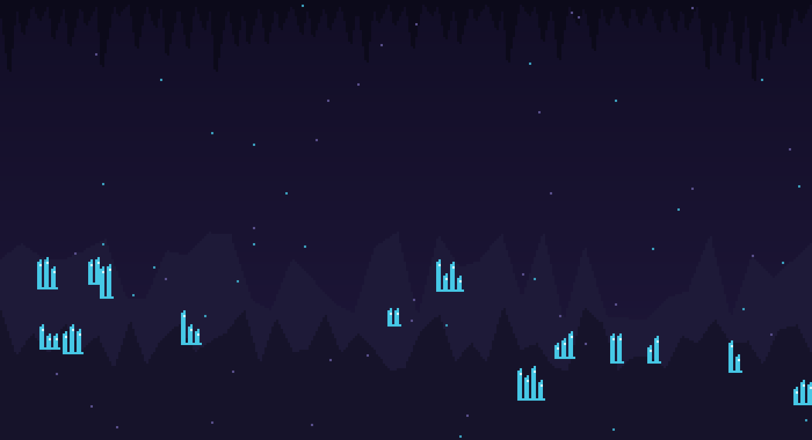
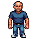

<p align="center">
  
</p>

<h1 align="center">HIDDEN WAY</h1>

<p align="center">
  Uma aventura 2D de plataforma, exploração e mistério.
</p>

<p align="center">
  <a href="#como-executar"></a>
  <a href="#fases"></a>
  <a href="#testar-fases-e-editar-o-mapa"></a>
</p>

---

## 📖 Sobre o jogo

Em **Hidden Way**, o jogador deverá explorar diferentes fases, atravessar plataformas, evitar armadilhas e resolver desafios para encontrar o caminho até a saída de cada nível.

É uma experiência **single-player**: use movimento, saltos e exploração para superar os desafios e encontrar a saída.

---

## 🎯 Objetivo e mecânicas

Explore os cenários, pule entre plataformas, colete as chaves e alcance a saída. O jogo inclui:

- Movimentação lateral e pulo
- Plataformas e obstáculos
- Coleta de itens e interação com elementos do cenário
- Inimigos terrestres e voadores
- Progressão por três fases

### Fases

1. **Mapa 1:** tutorial, chave, baú e saída pela caverna.
2. **A Caverna:** colete as chaves, evite os perigos e encontre a saída.
3. **O Céu:** atravesse as plataformas, enfrente inimigos e alcance o portal final.

## 🗺️ Galeria

<table>
  <tr>
    <td align="center"><strong>Mapa 1</strong></td>
    <td align="center"><strong>Fase 2 · A Caverna</strong></td>
    <td align="center"><strong>Fase 3 · O Céu </strong></td>
  </tr>
  <tr>
    <td></td>
    <td></td>
    <td></td>
  </tr>
</table>

<p align="center">
  <strong>Personagem</strong>
  &nbsp;&nbsp;
  
  &nbsp;&nbsp;&nbsp;&nbsp;
  <strong>Slime</strong>
  &nbsp;&nbsp;
  
  &nbsp;&nbsp;&nbsp;&nbsp;
  <strong>Morcego</strong>
  &nbsp;&nbsp;
  
  &nbsp;&nbsp;&nbsp;&nbsp;
  <strong>Chave</strong>
  &nbsp;&nbsp;
  
</p>


---

## ✨ Diferencial

O grande diferencial do projeto é trazer a proposta de jogos como **Fireboy and Watergirl** para um modo **single-player**, mantendo a essência da exploração e da resolução de desafios, mas utilizando apenas um personagem. 
---

## 🛠️ Tecnologias

- Python
- Pygame-CE
- Git
- GitHub

## 🎮 Controles

- **A / D** ou **setas esquerda / direita:** mover
- **Espaço:** pular
- **W / S** ou **setas cima / baixo:** movimento vertical no menu inicial
- **E:** interagir com elementos, como o baú
- **F3:** exibir/ocultar as paredes de colisão nas fases compatíveis
- **ESC:** voltar ao seletor de fases (quando iniciado pelo teste direto)

---

## 📂 Estrutura do projeto

```
Hidden Way/
├── assets/          # Cenários, sprites, efeitos e itens
├── classes/         # Estados, entidades e sistemas do jogo
├── teste/           # Seletor de fases e editores de plataformas/paredes
├── main.py          # Inicialização normal do jogo
└── README.md
```

---

## 🚀 Como executar

1. Clone o repositório

```bash
git clone https://github.com/ramosBlk/--Hidden-Way---.git
```

2. Entre na pasta

```bash
cd --Hidden-Way---
```

3. Instale a dependência

```bash
pip install pygame-ce
```

4. Inicie o jogo pelo menu

```bash
python main.py
```

### Executar no navegador com Pygbag

Pygbag transforma o Pygame em uma aplicação web que pode ser aberta em navegadores de computador.

1. Instale o Pygbag:

```bash
pip install pygbag
```

2. Execute o servidor local na pasta do projeto:

```bash
pygbag .
```

3. Abra o endereço exibido no terminal, normalmente:

```text
http://localhost:8000
```

Para criar os arquivos estáticos do site:

```bash
pygbag --build .
```

Os arquivos publicados estarão em `build/web`. Essa pasta pode ser enviada ao itch.io como projeto HTML ou publicada em um serviço de hospedagem estática.

### Publicar no GitHub Pages

Ao enviar alterações para a branch `homologaçãoblk`, o fluxo em
`.github/workflows/deploy-pages.yml` gera a versão web e publica o jogo automaticamente.

Na primeira publicação, acesse **Settings → Pages** no repositório do GitHub e selecione
**GitHub Actions** como origem.

## 🧪 Testar fases e editar o mapa

Os arquivos em `teste/` são ferramentas gráficas independentes do menu principal.

### Abrir uma fase diretamente

```bash
python teste/test_fases.py
```

Pressione **1**, **2** ou **3** para iniciar a fase desejada sem percorrer as anteriores. Durante a fase, **ESC** retorna ao seletor; no seletor, **ESC** fecha a ferramenta.

### Editores de plataformas e paredes

Execute o editor correspondente:

```bash
python teste/test_plataforma_fase2.py
python teste/test_paredes_fase2.py
python teste/test_plataforma_fase3.py
python teste/test_paredes_fase3.py
```

Nos editores, use **TAB** para trocar de elemento, **N** para adicionar, **DELETE** para excluir, as **setas** para mover, **Q/E** para ajustar a largura e **A/D** para ajustar a altura. **ENTER** imprime as coordenadas no terminal.

Os editores não salvam as coordenadas automaticamente. Depois de exportá-las, copie a lista impressa para a configuração correspondente em `classes/systems/fases.py`.

---

## 👨‍💻 Equipe

- Pedro Henrique Faria Silva
- Pedro Henrique Ramos de Carvalho
- Raphael Antonio Ferreira
- Victor Hugo Silva de Assis 

---

## 📚 Projeto Acadêmico

Desenvolvido para a disciplina **Programação para Jogos** do curso de **Ciência da Computação** do Centro Universitário Presidente Antônio Carlos (UNIPAC), sob orientação do professor **Rodrigo Fernandes dos Santos**.
